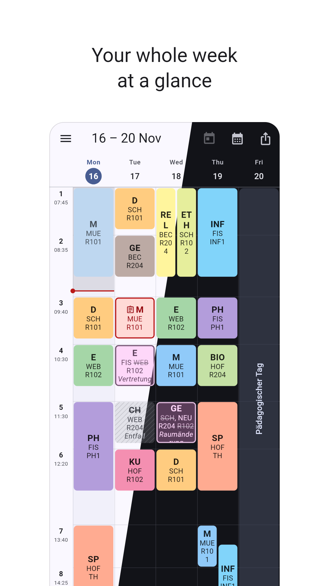
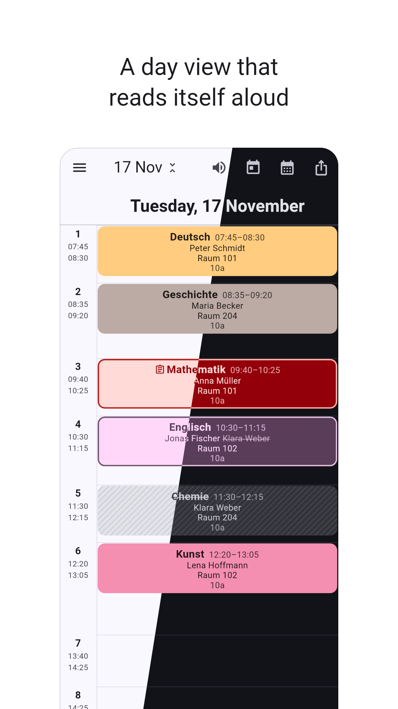
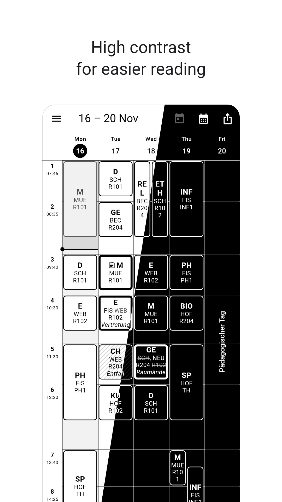
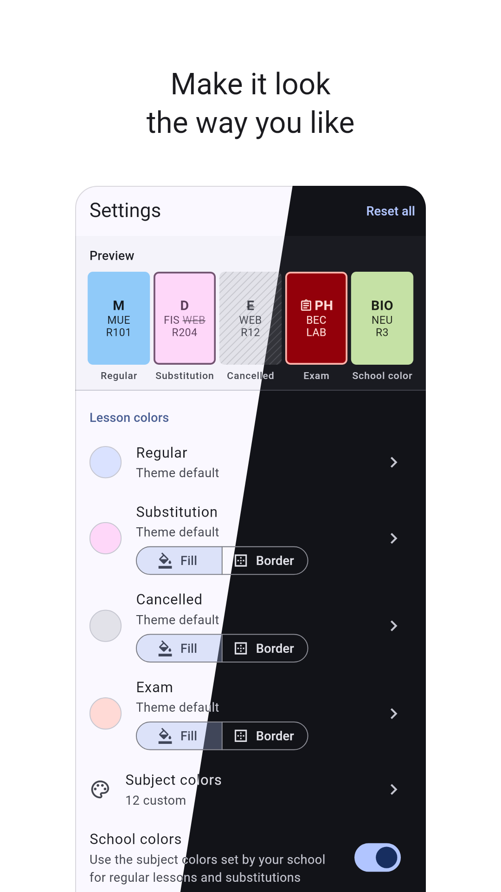
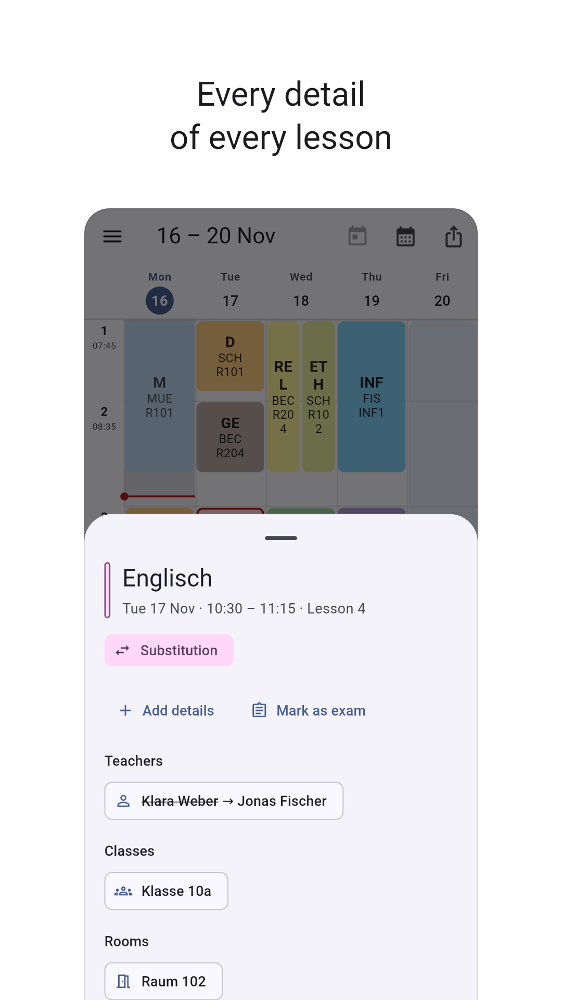
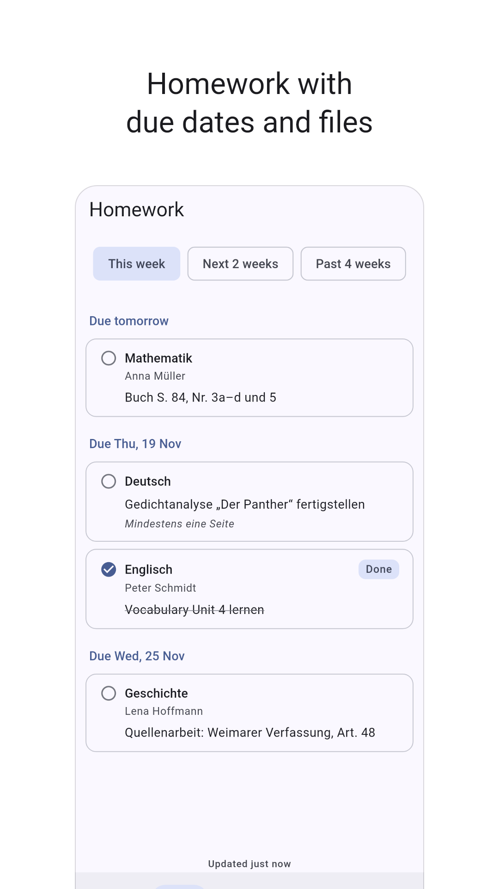
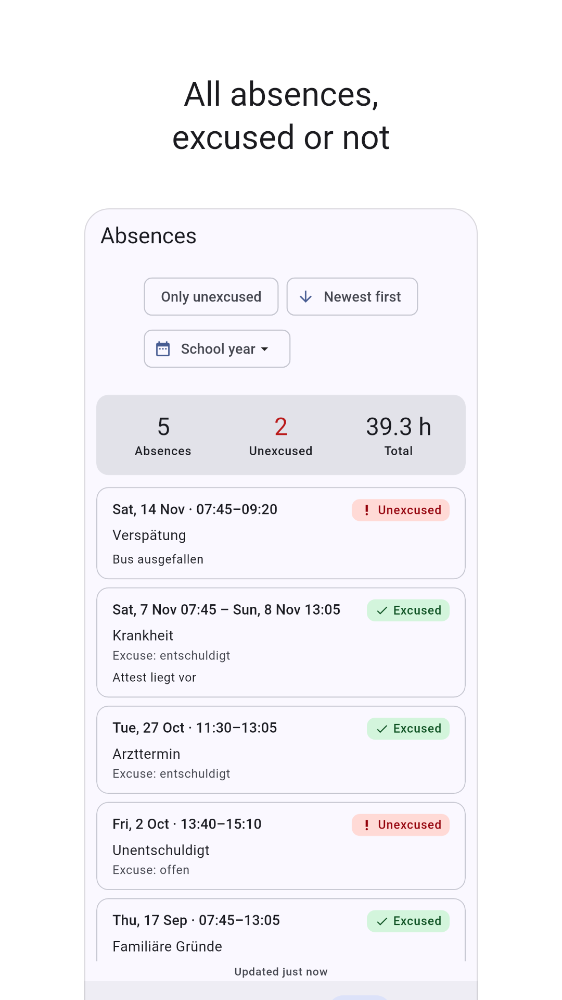
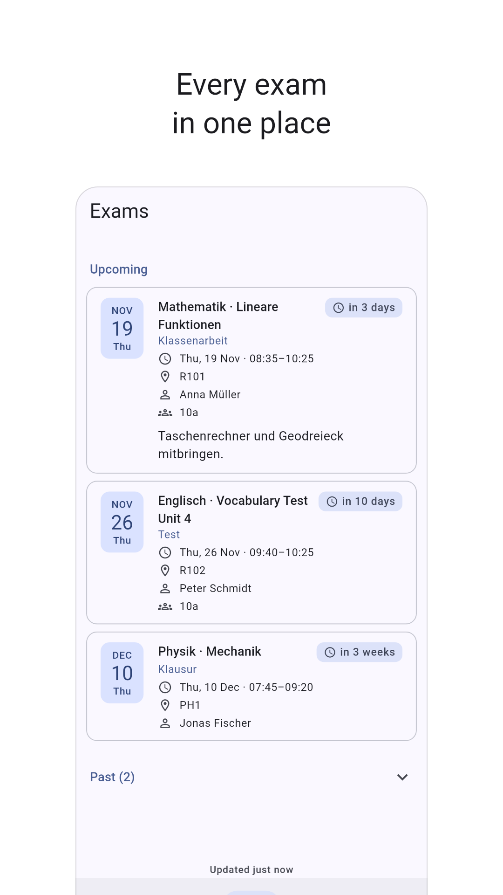

<div align="center">


# BetterBetterUntis

**A fast, friendly WebUntis timetable app for Android, iOS, iPadOS and the web.**

### 🌐 [Open the web version: better-betteruntis.eu](https://better-betteruntis.eu)

[](https://github.com/Brandart1/better-betteruntis/actions/workflows/ci.yml)
[](https://github.com/Brandart1/better-betteruntis/releases)
[](LICENSE)


</div>

BetterBetterUntis is a clean-room rewrite inspired by
[BetterUntis](https://github.com/SapuSeven/BetterUntis). It shows your school
timetable faster, works offline, handles several schools and children at once,
and fixes long-standing annoyances like **teachers missing from student
timetables**.

> [!NOTE]
> This is a beta. Most things work, but please
> [open an issue](https://github.com/Brandart1/better-betteruntis/issues) when
> something looks wrong at your school.

## 📸 Screenshots

<p align="center">
  
  
  
  
  
  
  
  
</p>

<sub>Top row: light mode left, dark mode right. Demo data — made-up school and names. Regenerate with `tool/screenshots/update.sh`.</sub>

## ✨ Features

**Timetable**
- Swipeable week view with merged double lessons, overlapping lessons side by side, holidays and a "now" line
- Tap a date to open that day full screen, then tap it again to go back to the week
- Cancelled lessons, substitutions and exams at a glance, with old → new teachers and rooms
- Cache-first and offline-capable: the timetable appears instantly, then refreshes
- Tap a lesson for details. Every teacher, class and room in it opens its own timetable

**Teachers and rooms, even when your school hides them**
- Teacher names are filled in from the WebUntis REST API when the classic API leaves them out
- Teacher and room timetables are rebuilt from every class timetable when the school doesn't publish them directly
- Room timetables show teacher and class, and hide the class when the lesson moved away or was cancelled

**Make it yours**
- Colours for regular lessons, substitutions, cancellations and exams: presets, hue slider or hex code
- **Per-subject colours**, e.g. Maths always blue
- For each special state, pick **fill** (whole lesson coloured) or **border** (keeps the subject colour)
- Text size, bold subject and centred text

**Accounts**
- Log in via school search, a QR code or manually (schools that use **ID Austria** for parents: log in on the web and scan the WebUntis QR code; the app shows how)
- Multiple accounts across different schools, switchable in one tap
- **Parent accounts:** "My timetable" shows your child; switch between several children in the drawer
- Credentials stay on your device (Keychain, Android Keystore, or your browser on the web)

**Info center**
- Messages of the day and inbox
- Homework and exams
- Absences, and **report an absence** for your child as a parent
- Office hours of all teachers, A–Z, optionally only your class's

**Export**
- Export any timetable as **CSV**, **XLSX**, **PDF** (using your colours and text settings) or as a **calendar file (.ics)**
- **Add to calendar:** keep a timetable in your phone's calendar, with separate coloured calendars for lessons, substitutions, exams and cancellations, updated when you open the app
- **Your own exams and notes:** mark any lesson as an exam and add details like topics or "mündliche Wiederholung"; saved on your device only, shown in the timetable and exports
- Pick a specific week, or the *regular* timetable derived from the last few weeks

**Sync (optional)**
- Sync your custom exams and lesson details between your devices. Off by default; turning it off deletes everything on the server
- Optional **end-to-end encryption** with a sync passphrase, so the server only stores data it can't read
- What is stored and why: [docs/PRIVACY.md](docs/PRIVACY.md)

**Web version**
- Hosted on Cloudflare, nothing to install. Your logins stay in your browser

## 🐞 Known issues

- None known right now.

## 📲 Install

| Platform | How |
| --- | --- |
| **Android** | Download the `.apk` from the [latest release](https://github.com/Brandart1/better-betteruntis/releases) and install it. |
| **iOS / iPadOS** | The release contains an **unsigned** `.ipa`. Sign it yourself with [Sideloadly](https://sideloadly.io), [AltStore](https://altstore.io) or your own developer account. With a free Apple ID, apps have to be re-signed every 7 days. |
| **Web** | Open `https://better-betteruntis.eu` in your browser. |

### 🌐 The web version

Browsers can't talk to WebUntis directly, so the web version runs on a
Cloudflare Worker that serves the app and forwards requests to
`*.webuntis.com`, and only there. Your login data is stored in your browser,
never on the server. The same Worker hosts the optional sync. It is deployed
automatically with every release; [docs/WEB.md](docs/WEB.md) and
[worker/README.md](worker/README.md) have the details.

Self-hosting (Docker / `bbu_server`) was removed in 0.5.0; it is still in
the 0.4.x releases.

## 🛠️ Building from source

Requires Flutter 3.47+.

```sh
flutter pub get
flutter test
flutter run                                         # device or emulator
flutter build apk --release                         # Android
flutter build web --release --no-web-resources-cdn  # web (served by worker/)
```

iOS builds run on GitHub Actions macOS runners (see `.github/workflows/`), so
no Mac is needed.

## 📚 Docs

- [docs/FEATURES.md](docs/FEATURES.md): feature parity checklist
- [docs/ARCHITECTURE.md](docs/ARCHITECTURE.md): how the code is organised
- [docs/API.md](docs/API.md): notes on the WebUntis protocol
- [docs/WEB.md](docs/WEB.md): the hosted web version and its WebUntis relay
- [docs/SYNC-PLAN.md](docs/SYNC-PLAN.md): sync design, security and end-to-end encryption
- [docs/PRIVACY.md](docs/PRIVACY.md): privacy notice for the web version and sync (draft)
- [worker/README.md](worker/README.md): the Cloudflare Worker: API, local dev, deployment and operations

## ⚖️ License & disclaimer

[GNU GPL v3](LICENSE). BetterBetterUntis is an independent project. It is **not
affiliated with or endorsed by Untis GmbH**. "WebUntis" is a trademark of its
respective owner.
